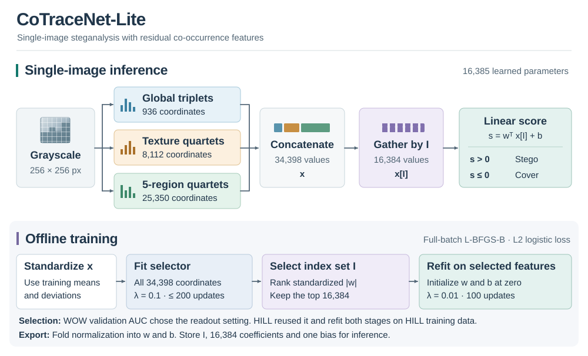

# CoTraceNet-Lite

**单张灰度图的轻量隐写检测。** CoTraceNet-Lite 统计相邻像素残差的组合，从 34,398 个特征中学习保留 16,384 个，再用一个线性分类器判断图像是否载密。输入为 256 × 256 的 8 位灰度图。推理用到 16,384 个浮点系数、1 个偏置和一张整数索引表。

在 BOSSbase 1.01 全库的同图对照中，迭代版在 WOW 0.4 bpp 上达到 **83.08%**，在 HILL 0.4 bpp 上达到 **76.82%**。相对于我们独立复现的 ShuffleBANet，Lite 的可学习推理参数减少 **97.49%**。本仓库发布我们编写的检测代码、实验脚本、结构图和汇总指标。图像、逐图特征、预测分数和模型权重均由下面的命令在本地生成。

## 方法



1. **提取局部统计。** 全图三阶共现产生 936 维特征，按纹理强度统计的四阶共现产生 8,112 维，五个活动区域的四阶共现产生 25,350 维。分区依据待测图自身估计，推理时只需一张图。
2. **学习保留哪些坐标。** 在训练集上逐维标准化特征，从零拟合带 L2 正则的逻辑回归（λ = 0.1，最多 200 次全批量 L-BFGS-B 更新），按标准化系数绝对值选出前 16,384 维。
3. **重新训练分类器。** 只用入选坐标，从零训练第二个逻辑回归。WOW 的 1,000 对验证图选中 λ = 0.01 和第 100 次更新。HILL 沿用这两个超参数，在自己的训练集上重新学习坐标和权重。部署时将标准化折入权重和偏置，分数大于零判为载密图。

## 主要结果

每种藏法各有 10,000 对普通图与载密图。按源照片分为 **6,000 对训练、1,000 对验证、3,000 对测试**。下表中，本项目的两种模型共用同一批测试图，以固定零阈值计算准确率，每个条件的分母均为 6,000 张。论文行直接引用表 X。AUC 为 ROC 曲线下面积。

| 方法 | 推理参数 | WOW 0.4 准确率 | WOW AUC | HILL 0.4 准确率 | HILL AUC |
|---|---:|---:|---:|---:|---:|
| ShuffleBANet，原文表 X 的 BOSS→BOSS | 约 0.66 M | 91.62% | 0.9813 | — | — |
| ShuffleBANet，独立复现，逐轮按验证 AUC 选权重 | 651,876 | 85.52% | 0.9519 | 76.62% | 0.8804 |
| **CoTraceNet-Lite，完整迭代训练** | **16,385** | **83.08%** | **0.9252** | **76.82%** | **0.8728** |

WOW 上，验证集选中复现 CNN 的第 30 轮权重，测试判对 5,131 张，Lite 判对 4,985 张。论文与本项目使用同样的数据规模和藏法，作者的具体测试清单未知。HILL 上，逐轮选优的 CNN 在第 13 轮选中，比 Lite 少判对 12 张。如果按预设的 20、50、100、200 轮四选一，验证集选中第 20 轮，测试准确率为 75.13%，AUC 为 0.8697。两种选轮规则的结果均有保留。[完整实验与机器可读结果](experiments/bossbase/README.md)

### 增益来自哪一步？

三行使用同一特征表示、同一推理参数量和同一源照片划分。每种藏法独立训练，报告单次固定划分（种子 73）的测试结果。

| 特征筛选 | 分类器拟合 | WOW 0.4 判对数 / 准确率 | HILL 0.4 判对数 / 准确率 |
|---|---|---:|---:|
| 配对 Fisher 方案 | 闭式拟合 | 4,705 / 78.42% | 4,441 / 74.02% |
| 保留 Fisher 方案的坐标 | 迭代逻辑回归 | 4,975 / 82.92% | 4,602 / 76.70% |
| 迭代逻辑回归 | 迭代逻辑回归 | **4,985 / 83.08%** | **4,609 / 76.82%** |

更换分类器贡献了大部分增益。再学习坐标后，WOW 多判对 10 张、HILL 多判对 7 张，两项差值按源照片配对的 95% 自助区间均跨过零。实验同时更换了判别目标和正则化，无法单独归因于优化器。[WOW 消融](experiments/bossbase/wow.json) · [HILL 消融](experiments/bossbase/hill.json)

### 推理速度与低误报筛查

- **单核速度。** 在 AMD EPYC 7H12 的同一 CPU 核上测量 24 张 HILL 测试图，每张重复三次。从读入 PGM 到输出分数，Lite 的单图中位耗时为 **64.44 ms**，复现 CNN 为 **291.78 ms**。该测量包含特征提取，权重已载入内存。[计时记录](experiments/bossbase/resources.json)
- **误报与漏检。** 在 HILL 上，完整迭代版相对闭式版少误报 290 张普通图，同时多漏检 122 张载密图。另在 WOW 上分别用验证普通图将两种模型的误报率设为 5%，锁定阈值后，Lite 在测试集误报 132 张、检出 1,847 张，CNN 误报 137 张、检出 2,222 张。漏检代价高时，这组数据支持优先考虑 CNN。[阈值与配对统计](experiments/bossbase/wow.json)

## 本地复现

以下命令在仓库根目录运行，使用 Python 3.10 或更高版本。自行下载 BOSSbase 1.01 官方 ZIP 并保留原始归档顺序。脚本用双三次插值先将普通图缩至 256 × 256，再生成用于检测评估的 WOW、HILL 0.4 bpp 模拟载密图。同源图在两种藏法中使用相同划分。四组内容重复的原图均留在训练集。生成后会校验划分及两种条件的全部图像摘要。[BOSSbase 1.01 官方归档](https://dde.binghamton.edu/download/ImageDB/BOSSbase_1.01.zip)

```sh
python -m pip install -r requirements.txt
python tools/prepare_fullscale.py --archive /path/to/BOSSbase_1.01.zip --out work/boss --workers 4

# 复核登记结果时使用与原实验相同的 CPU 数值库线程设置（Linux shell）
export OPENBLAS_NUM_THREADS=2 OMP_NUM_THREADS=2 MKL_NUM_THREADS=2

# WOW：用训练集拟合，以验证 AUC 选择正则强度与更新次数
python -m cotracenet.iterative fit --manifest work/boss/WOW_04/manifest.csv --out work/lite-wow --device cuda --workers 4

# HILL：沿用 WOW 的超参数，以 HILL 训练图从零拟合
python -m cotracenet.iterative fit --manifest work/boss/HILL_04/manifest.csv --recipe-from work/lite-wow --out work/lite-hill --device cuda --workers 4

# 单图预测，以及冻结权重后的两种藏法的测试
python -m cotracenet.iterative predict --fit work/lite-wow --image /path/to/grayscale.pgm
python -m cotracenet.iterative score --fit work/lite-wow --manifest work/boss/WOW_04/manifest.csv --split test --out outputs/wow/lite-test.csv --workers 4
python -m cotracenet.iterative score --fit work/lite-hill --manifest work/boss/HILL_04/manifest.csv --split test --out outputs/hill/lite-test.csv --workers 4
```

Lite 的拟合支持 `--device cpu`。全库训练特征矩阵有 12,000 × 34,398 个双精度元素，单个矩阵约占 3.08 GiB，拟合还需额外工作内存。输出模型保存在本地的 `model.npz`，`lock.json` 记录训练配置与模型摘要。对于自备数据，CSV 清单字段为 `source,split,cover,stego`，图像路径相对清单所在目录。同源普通图与载密图在同一行，`split` 取 `train`、`val` 或 `test`。

**发布前复核。** 用公开的数据准备脚本重新生成两组全库图像，逐一核对普通图、载密图的 SHA-256 与划分。随后在原实验的冻结特征上用公开求解器重新拟合，WOW 和 HILL 各自选出的 16,384 个坐标、全部浮点权重及偏置均与对应的存档模型一致。两个测试集各 6,000 张图的分类判决全部吻合。加上闭式和混合消融，六组模型一共复核 36,000 次判决，全部与存档一致。另从 1,024 张真实图像重新提取特征并打分，验证了图像到判决的入口。拟合复核使用 RTX 3090、NumPy 2.2.6、SciPy 1.15.3 和 PyTorch 2.11.0+cu126。其他数值库和线程设置可能影响筛选边界附近的特征排序。[复核记录](experiments/bossbase/reproduction.json)

<details>
<summary>复现闭式与迭代分类器的受控消融</summary>

```sh
# Hybrid 的登记实验使用单线程 BLAS
export OPENBLAS_NUM_THREADS=1 OMP_NUM_THREADS=1 MKL_NUM_THREADS=1
python -m cotracenet.iterative fit-fisher --manifest work/boss/WOW_04/manifest.csv --out work/fisher-wow --device cuda
python -m cotracenet.iterative fit --manifest work/boss/WOW_04/manifest.csv --indices-from work/fisher-wow --out work/hybrid-wow --device cuda
python -m cotracenet.iterative fit-fisher --manifest work/boss/HILL_04/manifest.csv --out work/fisher-hill --device cuda
python -m cotracenet.iterative fit --manifest work/boss/HILL_04/manifest.csv --indices-from work/fisher-hill --recipe-from work/hybrid-wow --out work/hybrid-hill --device cuda
```

分别将上述输出目录传给同一条 `score` 命令，即可在相同样本上比较判决。

</details>

<details>
<summary>复现 ShuffleBANet 全库 CNN 对照</summary>

原实验使用三张 GPU、同步批归一化和全局每批 15 对图。以下命令按每轮验证 AUC 选权重。HILL 的四档固定轮数对照在另一输出目录使用 `--selection fixed`。

```sh
python -m cotracenet.srm work/SRM_Kernels.npy
torchrun --standalone --nproc-per-node=3 -m cotracenet.fullscale_backbone train --manifest work/boss/WOW_04/manifest.csv --srm work/SRM_Kernels.npy --out work/cnn-wow --selection every
python -m cotracenet.fullscale_backbone score --manifest work/boss/WOW_04/manifest.csv --checkpoint work/cnn-wow/best.pt --split test --out outputs/wow/cnn-test.csv
torchrun --standalone --nproc-per-node=3 -m cotracenet.fullscale_backbone train --manifest work/boss/HILL_04/manifest.csv --srm work/SRM_Kernels.npy --out work/cnn-hill-fixed --selection fixed
```

</details>

## 论文、历史实验与许可

- ShuffleBANet 按 Hao Li 等人在 *IEEE Transactions on Dependable and Secure Computing* 发表的论文独立实现。CoTraceNet-Lite 的三路描述、特征选择、分类器训练与对比实验由本项目实现。[原论文 DOI](https://doi.org/10.1109/TDSC.2025.3596710)
- 早期的小样本闭式 Lite、带门控的 CoTraceNet 及其原始命令和实验数据汇总，归档在项目文档中。[早期版本与复现说明](docs/legacy.md)
- 原创代码和架构图采用 MIT 许可证。数据集及 CNN 使用的参考 SRM 滤波核分别遵循上游使用条款。[MIT 许可证](LICENSE) · [参考滤波核](https://github.com/SiaStg/SiaStegNet/blob/592d9e13f39f287d9c675f1b89272bcfb6a9627c/src/models/SRM_Kernels.npy)
