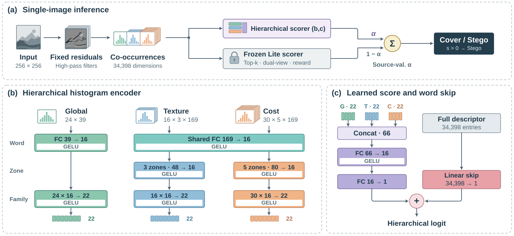
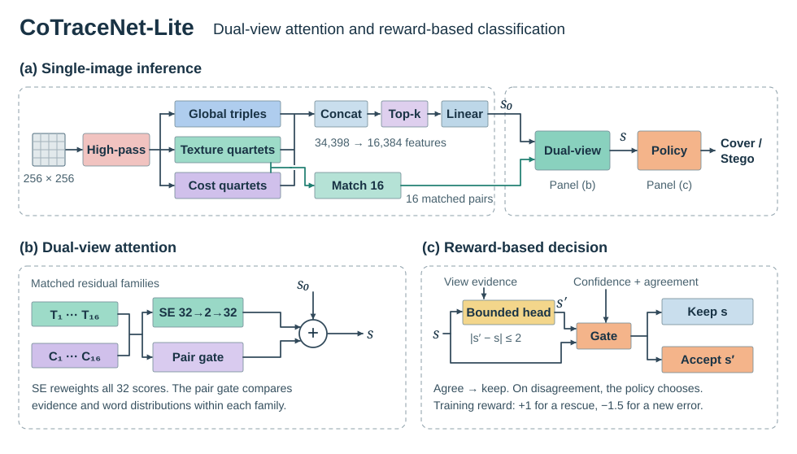

# CoTraceNet-Hier

**单图空间域隐写检测。** CoTraceNet-Hier 是本项目对分层残差共现模型的实验命名。模型从一张 256 × 256 灰度图提取全局、纹理分区和代价分区三路统计，在每组残差还保留分区身份时学习共现特征，最后与已有的双视角奖励模型融合。完整模型共有 **82,461 个参数**。仓库另收录论文基准 ShuffleBANet 的独立复现。[训练、消融与单图推理](experiments/feature_depth/README.md)



### 分层编码如何工作

1. **保留直方图的组织方式。** 全局路包含 24 组 39 维直方图。纹理路按 16 个残差族、每族 3 个区统计，代价路按 30 个残差族、每族 5 个区统计。后两路每个分区都含 169 个共现词，即相邻量化残差的取值组合。三个输入共 34,398 维。
2. **在每个族内比较分区，再整合不同残差族。** 纹理与代价两路共享 169→16 的词频编码，分别合并同族的 3 个或 5 个分区。三路各输出 22 维，拼接后用 66→16→1 的读出层分类。新分支同时从完整词表保留一条线性直连。
3. **融合两个判别分数。** 原 16,828 参数的双视角奖励模型保持冻结。新分支有 65,633 个可学习参数，其稠密层每张图新增 661,166 MAC，即 1,322,332 FLOPs。源域验证集选定融合系数 α，推理时单独处理每一张图。

### BOSSbase 0.4 bpp 检测结果

BOSSbase 1.01 的 10,000 张原图先由 512 × 512 双三次缩放至 256 × 256，再按 WOW、HILL 的 0.4 bpp 嵌入改动概率分别生成模拟载密图。每种藏法分为 **6,000 对训练、1,000 对验证、3,000 对测试**。箭头左侧为训练藏法，右侧为测试藏法，每格准确率的分母为 6,000 张。模型与融合系数均在查看候选测试结果前确定。

| 方案 | 完整参数量 | WOW → WOW | HILL → HILL | WOW → HILL | HILL → WOW |
|---|---:|---:|---:|---:|---:|
| 冻结的 CoTraceNet-Lite 双视角奖励模型 | 16,828 | 83.15% | 77.23% | 70.25% | 78.00% |
| **CoTraceNet-Hier，种子 73** | **82,461** | **84.83%** | **79.38%** | **71.30%** | **79.07%** |
| **CoTraceNet-Hier，种子 29** | **82,461** | **84.85%** | **79.18%** | **71.02%** | **78.98%** |
| 三路残差 MLP，种子 73 | 83,857 | 84.17% | 77.57% | 70.88% | 78.48% |
| 三路浅层 MLP，种子 73 | 83,135 | 84.07% | 77.67% | 71.65% | 78.90% |
| 空间网格卷积，种子 73 | 78,525 | 83.15% | 77.23% | 69.92% | 78.00% |

两次初始化共用划分与冻结模型，各训练新增分支 **24 轮**。种子 73 的 WOW、HILL 验证集分别选中第 24、12 轮，α 均为 0.75。种子 29 两域均选中第 24 轮，α 分别为 0.50、0.75。相对冻结模型，WOW 同域两次分别净多判对 **101、102 张**，HILL 同域分别净多判对 **129、117 张**。[各方向的正确数、准确率差与配对 95% 区间](docs/feature-depth-results.csv)

**增益来自哪里？** 给单独训练的线性对照相同的 34,398 维输入和融合机会，种子 73 的 WOW、HILL 同域结果分别为 83.17%、77.23%。CoTraceNet-Hier 又分别多判对 100、129 张。单独运行新的分层分支，两项同域准确率已达 84.40%、78.32%；接回冻结模型后均有提升。同一轮的浅层 MLP 在 WOW→HILL 取得 71.65%，说明跨藏法时架构排序也会改变。

## CoTraceNet-Lite 双视角奖励模型

双视角模型保留三路残差共现得到的 Lite 基础分数，把同一种残差在纹理分区和代价分区中的证据配成 16 对，用两级注意力修正分数。最终分类器在原判与有界备选判决之间做一次选择。这一版本是上表中的冻结对照。[训练与单图推理](docs/binocular.md)



| 实现 | 用途 | 入口 |
|---|---|---|
| 双视角奖励分类 | 训练冻结对照，执行同域或跨藏法测试与单图推理 | [binocular](cotracenet/binocular/) |
| 固定块与主动选块复查 | 在相同样本上比较保持原判、固定位置复查、按分歧选块复查 | [local_review](cotracenet/local_review/) |
| 基础 Lite | 三路残差、特征筛选和线性分类，亦用于训练双视角模型的底座 | [iterative.py](cotracenet/iterative.py) |

## 基础 Lite 与既有实验

**单张灰度图的轻量隐写检测。** CoTraceNet-Lite 统计相邻像素残差的组合，从 34,398 个特征中学习保留 16,384 个，再用一个线性分类器判断图像是否载密。输入为 256 × 256 的 8 位灰度图。推理用到 16,384 个浮点系数、1 个偏置和一张整数索引表。

在基础 Lite 的既有全库实验中，WOW 0.4 bpp 的准确率为 **87.08%**，HILL 0.4 bpp 为 **76.82%**。相对于我们独立复现的 ShuffleBANet，Lite 的可学习推理参数减少 **97.49%**。本节报告该次训练归档。上方分层增量实验以实际回放的 16,828 参数双视角奖励模型为基线。[完整实验指标](experiments/bossbase/results_summary.json)

### 基础 Lite 的方法


1. **提取局部统计。** 全图三阶共现产生 936 维特征，按纹理强度统计的四阶共现产生 8,112 维，五个活动区域的四阶共现产生 25,350 维。分区依据待测图自身估计，推理时只需一张图。
2. **学习保留哪些坐标。** 在训练集上逐维标准化特征，从零拟合带 L2 正则的逻辑回归（λ = 0.1，最多 200 次全批量 L-BFGS-B 更新），按标准化系数绝对值选出前 16,384 维。
3. **重新训练分类器。** 只用入选坐标，从零训练第二个逻辑回归。WOW 的 1,000 对验证图选中 λ = 0.01 和第 100 次更新。HILL 沿用这两个超参数，在自己的训练集上重新学习坐标和权重。部署时将标准化折入权重和偏置，分数大于零判为载密图。

## 基础 Lite 与 ShuffleBANet 的对照结果

每种藏法各有 10,000 对普通图与载密图。按源照片分为 **6,000 对训练、1,000 对验证、3,000 对测试**。下表中，本项目的两种模型共用同一批测试图，以固定零阈值计算准确率，每个条件的分母均为 6,000 张。论文行直接引用表 X。AUC 为 ROC 曲线下面积。

| 方法 | 推理参数 | WOW 0.4 准确率 | WOW AUC | HILL 0.4 准确率 | HILL AUC |
|---|---:|---:|---:|---:|---:|
| ShuffleBANet，原文表 X 的 BOSS→BOSS | 约 0.66 M | 91.62% | 0.9813 | — | — |
| ShuffleBANet，独立复现，逐轮按验证 AUC 选权重 | 651,876 | 89.52% | 0.9719 | 76.62% | 0.8804 |
| **CoTraceNet-Lite，完整迭代训练** | **16,385** | **87.08%** | **0.9552** | **76.82%** | **0.8728** |

WOW 上，复现 CNN 第 30 轮的验证 AUC 为 0.9569，Lite 第 100 次更新为 0.9406。复现 CNN 的测试准确率比论文低 2.10 个百分点。论文与本项目使用同一数据规模，作者的具体测试清单未知。HILL 上，逐轮选优的 CNN 在第 13 轮选中，比 Lite 少判对 12 张。按预设的 20、50、100、200 轮四选一时，验证集选中第 20 轮，测试准确率为 75.13%，AUC 为 0.8697。[完整实验与两种选轮口径](experiments/bossbase/README.md)

### 增益来自哪一步？

三种配置的推理参数均为 16,385 个，WOW 与 HILL 各自训练和测试。

| 特征筛选 | 分类器拟合 | WOW 0.4 准确率 | HILL 0.4 准确率 |
|---|---|---:|---:|
| 配对 Fisher 方案 | 闭式拟合 | 78.42% | 74.02% |
| 保留 Fisher 方案的坐标 | 迭代逻辑回归 | 82.92% | 76.70% |
| 迭代逻辑回归 | 迭代逻辑回归 | **87.08%** | **76.82%** |

在 WOW 上，更换分类器和重新筛选特征分别多判对 270 张和 250 张，准确率两步分别提高 4.50 和约 4.2 个百分点。在 HILL 上，两步分别多判对 161 张和 7 张，提升主要来自分类器训练。相对闭式基线，完整模型在 WOW 上多判对 520 张、在 HILL 上多判对 168 张。[训练消融的计数与准确率](experiments/bossbase/results_summary.json)

### 冻结权重后更换藏法

在 BOSSbase 的同一组测试源照片上，冻结各模型的权重与零阈值，直接评估另一种藏法，载荷均为 0.4 bpp。按每轮源域验证 AUC 选 CNN 权重时，WOW 训练、HILL 测试的准确率为 Lite **70.68%**、CNN **62.67%**。反向为 Lite **78.00%**、CNN **75.70%**。[跨藏法准确率与 AUC](experiments/bossbase/results_summary.json)

### 推理速度与低误报筛查

- **单核速度。** 在 AMD EPYC 7H12 的同一 CPU 核上测量 24 张 HILL 测试图，每张重复三次。从读入 PGM 到输出分数，Lite 的单图中位耗时为 **64.44 ms**，复现 CNN 为 **291.78 ms**。该测量包含特征提取，权重已载入内存。[计时记录](experiments/bossbase/resources.json)
- **低误报筛查。** 在 WOW 上，分别用验证普通图将两种模型的误报率设为 5%，锁定阈值后，Lite 在测试集误报 132 张、检出 2,084 张（69.47%），CNN 误报 137 张、检出 2,222 张（74.07%）。CNN 多误报 5 张普通图，多检出 138 张载密图。[低误报实验](experiments/bossbase/results_summary.json)

## 复现基础 Lite

以下命令在仓库根目录运行，使用 Python 3.10 或更高版本。自行下载 BOSSbase 1.01 官方 ZIP 并保留原始归档顺序。脚本用双三次插值先将普通图缩至 256 × 256，再生成用于检测评估的 WOW、HILL 0.4 bpp 模拟载密图。同源图在两种藏法中使用相同划分。四组内容重复的原图均留在训练集。生成后会校验划分及两种条件的全部图像摘要。[BOSSbase 1.01 官方归档](https://dde.binghamton.edu/download/ImageDB/BOSSbase_1.01.zip)

```sh
python -m pip install -r requirements.txt
python tools/prepare_fullscale.py --archive /path/to/BOSSbase_1.01.zip --out work/boss --workers 4

# 复核登记结果时使用与原实验相同的 CPU 数值库线程设置（Linux shell）
export OPENBLAS_NUM_THREADS=2 OMP_NUM_THREADS=2 MKL_NUM_THREADS=2

# WOW：用训练集拟合，以验证 AUC 选择正则强度与更新次数
python -m cotracenet.iterative fit --manifest work/boss/WOW_04/manifest.csv --out work/lite-wow --device cuda --workers 4

# HILL：沿用 WOW 的超参数，以 HILL 训练图从零拟合
python -m cotracenet.iterative fit --manifest work/boss/HILL_04/manifest.csv --recipe-from work/lite-wow --out work/lite-hill --device cuda --workers 4

# 单图预测，以及冻结权重后的两种藏法的测试
python -m cotracenet.iterative predict --fit work/lite-wow --image /path/to/grayscale.pgm
python -m cotracenet.iterative score --fit work/lite-wow --manifest work/boss/WOW_04/manifest.csv --split test --out outputs/wow/lite-test.csv --workers 4
python -m cotracenet.iterative score --fit work/lite-hill --manifest work/boss/HILL_04/manifest.csv --split test --out outputs/hill/lite-test.csv --workers 4
```

Lite 的拟合支持 `--device cpu`。全库训练特征矩阵有 12,000 × 34,398 个双精度元素，单个矩阵约占 3.08 GiB，拟合还需额外工作内存。输出模型保存在本地的 `model.npz`，`lock.json` 记录训练配置与模型摘要。对于自备数据，CSV 清单字段为 `source,split,cover,stego`，图像路径相对清单所在目录。同源普通图与载密图在同一行，`split` 取 `train`、`val` 或 `test`。

**逐图复算归档。** 版本 `f8e47d6` 保存了对应模型的逐图复核、混淆矩阵、配对置信区间与验证曲线。该版本在已有的冻结特征上重拟合后，六组模型共 36,000 次判决与存档一致。[版本归档与复算步骤](https://github.com/DuanQiChao888/CoTraceNet/tree/f8e47d6a81c31a808d26fa0443e293d323054e15/experiments/bossbase)

<details>
<summary>复现闭式与迭代分类器的受控消融</summary>

```sh
# Hybrid 的登记实验使用单线程 BLAS
export OPENBLAS_NUM_THREADS=1 OMP_NUM_THREADS=1 MKL_NUM_THREADS=1
python -m cotracenet.iterative fit-fisher --manifest work/boss/WOW_04/manifest.csv --out work/fisher-wow --device cuda
python -m cotracenet.iterative fit --manifest work/boss/WOW_04/manifest.csv --indices-from work/fisher-wow --out work/hybrid-wow --device cuda
python -m cotracenet.iterative fit-fisher --manifest work/boss/HILL_04/manifest.csv --out work/fisher-hill --device cuda
python -m cotracenet.iterative fit --manifest work/boss/HILL_04/manifest.csv --indices-from work/fisher-hill --recipe-from work/hybrid-wow --out work/hybrid-hill --device cuda
```

分别将上述输出目录传给同一条 `score` 命令，即可在相同样本上比较判决。

</details>

<details>
<summary>复现 ShuffleBANet 全库 CNN 对照</summary>

原实验使用三张 GPU、同步批归一化和全局每批 15 对图。以下命令按每轮验证 AUC 选权重。HILL 的四档固定轮数对照在另一输出目录使用 `--selection fixed`。

```sh
python -m cotracenet.srm work/SRM_Kernels.npy
torchrun --standalone --nproc-per-node=3 -m cotracenet.fullscale_backbone train --manifest work/boss/WOW_04/manifest.csv --srm work/SRM_Kernels.npy --out work/cnn-wow --selection every
python -m cotracenet.fullscale_backbone score --manifest work/boss/WOW_04/manifest.csv --checkpoint work/cnn-wow/best.pt --split test --out outputs/wow/cnn-test.csv
torchrun --standalone --nproc-per-node=3 -m cotracenet.fullscale_backbone train --manifest work/boss/HILL_04/manifest.csv --srm work/SRM_Kernels.npy --out work/cnn-hill-fixed --selection fixed
```

</details>

## 论文、历史实验与许可

- ShuffleBANet 按 Hao Li 等人在 *IEEE Transactions on Dependable and Secure Computing* 发表的论文独立实现。CoTraceNet-Lite 的三路描述、特征选择、分类器训练与对比实验由本项目实现。[原论文 DOI](https://doi.org/10.1109/TDSC.2025.3596710)
- 早期的小样本闭式 Lite、带门控的 CoTraceNet 及其原始命令和实验数据汇总，归档在项目文档中。[早期版本与复现说明](docs/legacy.md)
- 原创代码和架构图采用 MIT 许可证。数据集及 CNN 使用的参考 SRM 滤波核分别遵循上游使用条款。[MIT 许可证](LICENSE) · [参考滤波核](https://github.com/SiaStg/SiaStegNet/blob/592d9e13f39f287d9c675f1b89272bcfb6a9627c/src/models/SRM_Kernels.npy)
