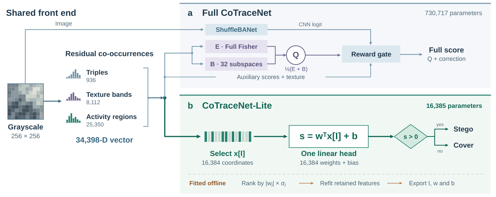
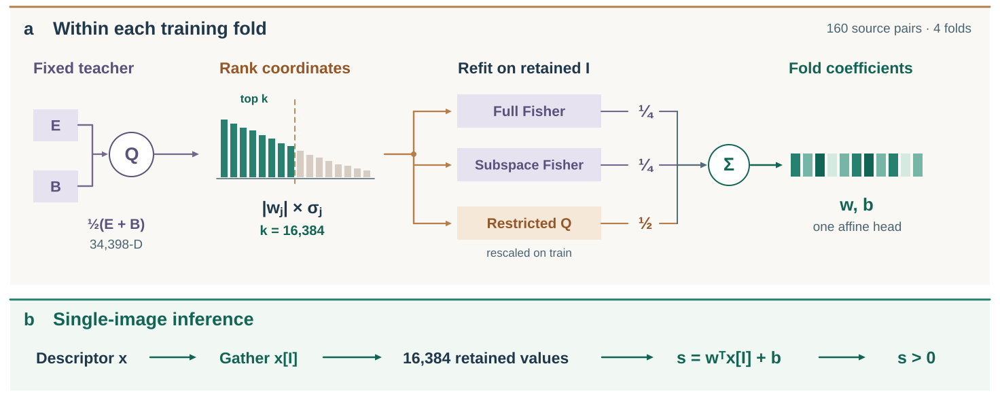
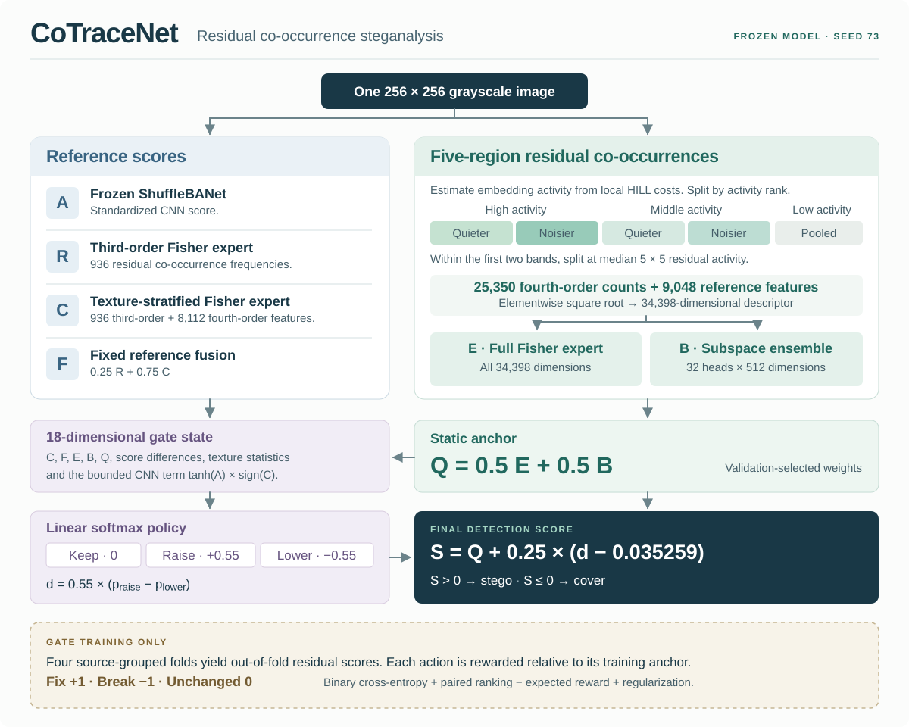

# 早期小样本实验与闭式 CoTraceNet-Lite

输入一张 256 × 256 的灰度图，检测其中是否嵌入了消息。**CoTraceNet-Lite** 保留分区残差共现特征，用 **16,384 个权重和 1 个偏置**作出判断。相对完整版，参数减少 **97.76%**。在本项目服务器的单核 CPU 上，单图中位耗时从 313.98 ms 降至 64.51 ms。

## CoTraceNet-Lite 的训练与推理



1. **折叠固定融合。** 全维专家 E 与随机子空间专家 B 读取同一个 34,398 维向量。两组权重和偏置各自取平均，就能精确复现固定融合分数 `Q = (E + B) / 2`。Q 可独立运行，所需权重和偏置共 34,399 个。
2. **剪枝并重新拟合。** 在每个训练折内按 `abs(w_Q) × std(x)` 排序。对保留的坐标重新训练配对 Fisher 和随机子空间判别器，再与重新校准的截断 Q 得分取平均。验证选中 16,384 维。所有线性操作在部署前合并。
3. **单图打分。** 提取三阶、纹理四阶和五区残差共现，按训练选定的索引取值，做一次内积并加偏置。分数大于零时判为载密。Lite 推理无需 CNN、原图配对或标签。权重文件还保存 16,384 个整型索引，实测压缩后为 157,129 字节。

<details>
<summary>展开剪枝、重新拟合与系数折叠的训练图</summary>



</details>

### HILL 0.4 bpp 同图对照

| 模型 | 推理权重与偏置 | 原测试准确率 | 新盲测准确率 | 新盲测 AUC |
|---|---:|---:|---:|---:|
| CoTraceNet | 730,717 | 357/512 · 69.73% | 346/512 · 67.58% | 0.7555 |
| 同专家固定融合 Q | 34,399 | 357/512 · 69.73% | **351/512 · 68.55%** | 0.7554 |
| **CoTraceNet-Lite** | **16,385** | **363/512 · 70.90%** | 348/512 · 67.97% | **0.7586** |

种子 73。用 160 对图训练、48 对图验证；新盲测预先排除以往用过的 1,408 张源照片，再抽取 256 张新来源。Lite 在新盲测上相对完整版改对 12 张、改错 10 张，差值为 +0.39 个百分点，按源照片配对的 95% 自助区间为 −1.17 至 +1.95。固定融合在这批图上多判对 3 张。两组结果支持大幅压缩后的精度保持，微小差异仍需多种子验证。[五条件结果、消融与计时](../experiments/lite73/README.md) · [汇总数据](../experiments/lite73/metrics.csv)

### 从原图训练 Lite

在仓库根目录执行。准备数据需要自行取得 BOSSbase 1.01 压缩包。GPU 训练使用已安装的 CUDA 版 PyTorch，可用 `--device cpu` 改为 CPU 训练。

```sh
python -m pip install -r requirements.txt -r tools/requirements-data.txt
python tools/prepare_pairs.py --archive path/to/BOSSbase_1.01.zip --out work/data
python -m cotracenet.lite fit --manifest work/data/train/manifest.csv --out work/lite --device cuda
python -m cotracenet.lite predict --fit work/lite --image path/to/image.pgm
python -m cotracenet.lite score --fit work/lite --manifest work/data/test/HILL_04/manifest.csv --out outputs/prior/lite.csv
python tools/prepare_pairs.py --archive path/to/BOSSbase_1.01.zip --out work/fresh --cohort fresh --conditions HILL_04
python -m cotracenet.lite score --fit work/lite --manifest work/fresh/test/HILL_04/manifest.csv --out outputs/fresh/lite.csv
```

在远程 RTX 3090 上从 416 张原始训练与验证图重新提取特征并拟合，生成的模型文件与实验锁逐字节一致。模型、样本和逐图预测均由使用者在本地生成。[数据协议](data.md) · [评分和复核命令](../experiments/lite73/README.md)

## 完整版 CoTraceNet



1. **从残差读出局部变化。** 模型从待测图自身估计修改代价，用代价排序与局部残差幅值划出五个区域。把区域内的四阶共现频率与已有残差特征拼接，得到 34,398 维描述。
2. **从两个视角打分。** 全维判别器 E 使用全部特征，子空间判别器 B 平均 32 个 512 维判别器的输出。种子 73 的验证集选中了等权组合，初始分数为 `Q = (E + B) / 2`。
3. **控制改判幅度。** 门控读取纹理、专家分歧和冻结的 ShuffleBANet 响应，为保留、上调和下调分配概率。训练时，纠正原判断得 +1，推翻正确判断得 −1，并加入同源普通图与载密图的排序损失。推理只需一张图，最终分数大于零即判为载密。

## 同一小样本协议下的五条件比较

以下各行均来自本项目复现。五个条件复用原测试组的 256 张源照片，每列含 256 张普通图和 256 张载密图。表中单位为准确率（%）。

| 模型 | WOW 0.1 | WOW 0.4 | HILL 0.1 | HILL 0.4 | J-UNIWARD 0.3 |
|---|---:|---:|---:|---:|---:|
| SRNet | 50.00 | 50.00 | 50.00 | 50.00 | 50.00 |
| ShuffleBANet | 51.17 | 53.13 | 50.59 | 52.15 | 49.22 |
| CoTraceNet | 51.56 | 70.12 | 51.17 | 69.73 | 49.80 |
| **CoTraceNet-Lite** | **53.13** | **71.09** | **52.15** | **70.90** | **49.80** |

HILL 与 WOW 的载荷单位为 bpp。J-UNIWARD 使用 QF85 的 JPEG，载荷为每个非零交流系数 0.3 比特。所有模型仅在 HILL 0.4 上训练。

在预先指定的 HILL 0.4 条件下，CoTraceNet 判对 **357/512** 张，比上一版四阶残差专家多判对 **22 张**，比上一版固定融合多判对 **27 张**。保留本版两个 Fisher 判别器并固定其权重，也判对 357 张。逐图门控救回 1 张、改错 1 张。低载荷和 JPEG 条件下的准确率均接近 50%。[实验协议和消融](../experiments/README.md) · [汇总指标](../experiments/seed73/metrics.csv) · [配对比较](../experiments/seed73/paired.csv)

发布前使用同一组历史冻结权重，让此仓库的推理入口重新处理 HILL 0.4 的全部 512 张图。与原实验逐图对照，512 个分类判断全部一致，最终分数最大绝对误差小于 `4.7e-8`。另一次复算仅沿用原 CNN 骨干，使用公开代码重新拟合全部残差专家与门控，仍得到相同的 512 个判断、357 个正确分类和 0.7722168 的 AUC。

## 完整版与 CNN 基线的训练和推理

在仓库根目录安装 Python 依赖。训练支持 CUDA，单图推理也可在 CPU 上运行。若使用 GPU，请先安装与当前 CUDA 环境匹配的 PyTorch。

```sh
python -m pip install -r requirements.txt
python -m cotracenet.srm work/SRM_Kernels.npy
```

以下命令复用上面生成的 `work/data`。训练清单使用 `source,split,cover,stego` 四列，两个图像路径相对于清单所在目录。`source` 标识原照片，同源普通图和载密图应在同一行、同一划分。训练清单包含 `train`、`val` 两组，测试清单使用 `test`。图像为 8 位、单通道、256 × 256。[BOSSbase 数据准备](data.md)

```sh
python -m cotracenet.train_backbone --manifest work/data/train/manifest.csv --srm work/SRM_Kernels.npy --out work/backbone --device cuda
python -m cotracenet fit --manifest work/data/train/manifest.csv --backbone work/backbone/best.pt --out work/model --device cuda
python -m cotracenet predict --image path/to/image.pgm --backbone work/backbone/best.pt --fit work/model --device cpu
python -m cotracenet score --manifest work/data/test/HILL_04/manifest.csv --backbone work/backbone/best.pt --fit work/model --out outputs/cotracenet/HILL_04/scores.csv --device cuda
```

对同一组源照片的其余四个条件分别执行 `score`，即可从输出的逐图分数重算汇总表。ShuffleBANet 的分数保存在该文件的 `baseline` 列。SRNet 对照可单独训练和评分。[五条件汇总命令及输出格式](../experiments/README.md#recompute-the-summaries)

```sh
python -m cotracenet.srnet train --manifest work/data/train/manifest.csv --out work/srnet --device cuda
python -m cotracenet.srnet score --manifest work/data/test/HILL_04/manifest.csv --fit work/srnet --out outputs/srnet/HILL_04 --device cuda
```

## 原论文与外部资源

- ShuffleBANet 骨干按 Hao Li 等人的 *A Convolutional Neural Network Steganalysis Method Based on ShuffleBottleneck and Attention Mechanism* 独立实现。CoTraceNet 是在此基础上设计的课程研究方法。[原论文](https://doi.org/10.1109/TDSC.2025.3596710)
- SRNet 对照对应 Boroumand、Chen 和 Fridrich 的 *Deep Residual Network for Steganalysis of Digital Images*。[作者发布页](https://dde.binghamton.edu/download/feature_extractors/)
- 骨干预处理使用 SiaStegNet 提供的 30 个参考 SRM 滤波核。`cotracenet.srm` 从固定版本获取文件并校验 SHA-256。[上游文件](https://github.com/SiaStg/SiaStegNet/blob/592d9e13f39f287d9c675f1b89272bcfb6a9627c/src/models/SRM_Kernels.npy)

本仓库的原创代码与架构图按 MIT 许可证发布。外部数据集、滤波核和依赖分别遵循其上游使用条款。[MIT 许可证](../LICENSE)
